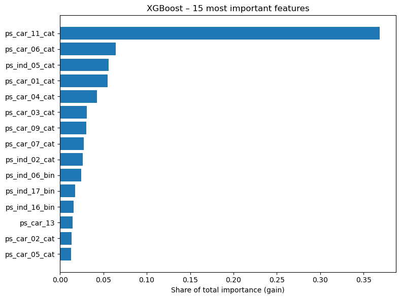
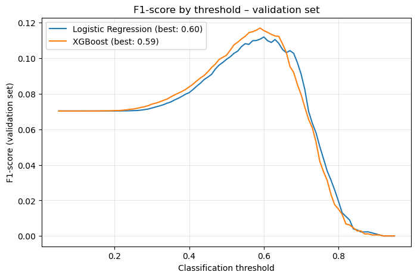
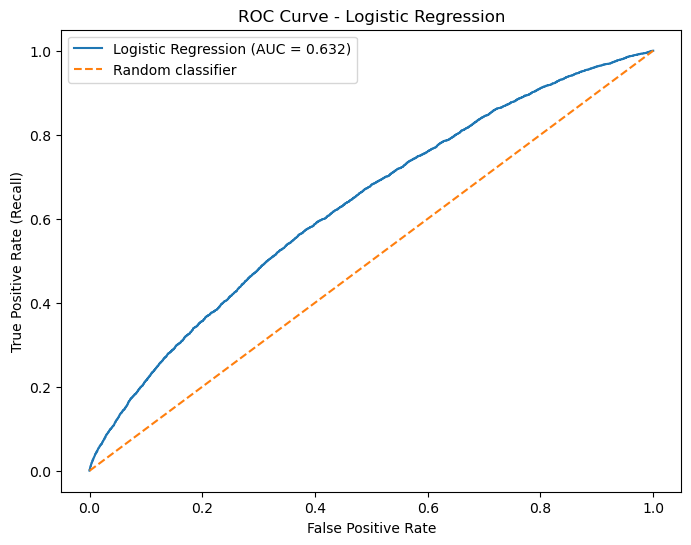
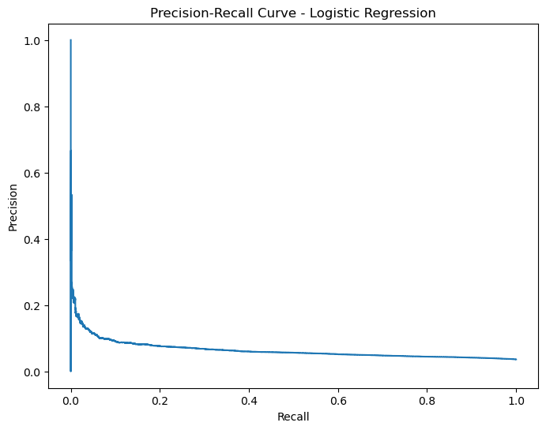
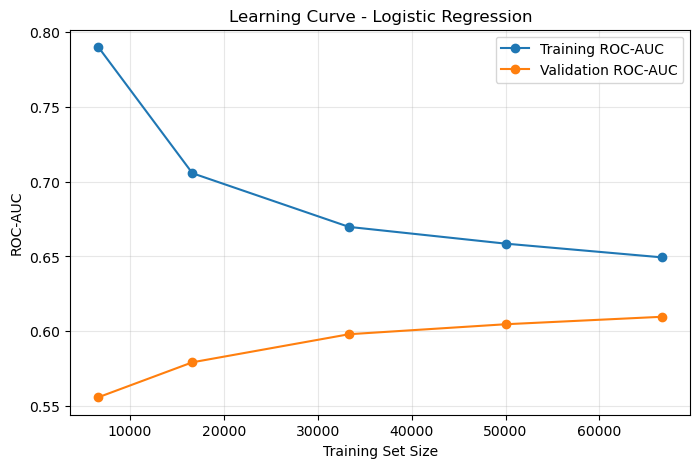

# Porto Seguro – Vorhersage von Versicherungsschäden

**Machine-Learning-Projekt: Klassifikation seltener Schadenfälle in 595.212 Kfz-Versicherungsverträgen**

Python · Scikit-learn · XGBoost · Pipelines · Cross-Validation · Imbalanced Classification

*English version: [README_EN.md](README_EN.md)*

---

## Ergebnisse auf einen Blick

| Bereich | Ergebnis |
|---|---|
| **Daten** | 595.212 Versicherungsverträge, 57 anonymisierte Merkmale, nur **3,64 %** mit Schaden |
| **Vorverarbeitung** | Scikit-learn-Pipelines (Imputation, Skalierung, One-Hot-Encoding), ausschließlich auf Trainingsdaten gelernt |
| **Bestes Modell** | **XGBoost**: Test-ROC-AUC **0,636**, Normalized Gini **0,272** (Logistic Regression: 0,631 / 0,263) |
| **Class Imbalance** | Klassengewichte erhöhen den Recall von 0,07 % auf 56 %; Accuracy allein ist irreführend |
| **Schwellenwert** | Auf separatem Validierungsdatensatz gewählt: F1-Score 0,099 → **0,114**, rund 28.000 weniger Fehlalarme |
| **Business Value** | Die 10 % risikoreichsten Verträge enthalten **21,5 %** aller Schäden (2× so viele wie bei Zufallsauswahl) |
| **Merkmalsanalyse** | `ps_car_11_cat` ist das wichtigste Merkmal; ohne die 20 `ps_calc_*`-Merkmale wird das Modell leicht besser |
| **Validierung** | Stratifizierte Aufteilung in Training, Validierung und Test; 5-fache Cross-Validation (Gini 0,257 ± 0,006) |



---

## 1. Projektübersicht

Dieses Repository dokumentiert meinen persönlichen Beitrag zu einem universitären Gruppenprojekt im Modul **Advanced Data Analytics**.

Ziel ist es vorherzusagen, ob ein Versicherungsnehmer einen Schaden melden wird. Grundlage ist der Datensatz der Kaggle-Challenge *Porto Seguro's Safe Driver Prediction*.

**Zentrale Fragestellung:** Kann ein Machine-Learning-Modell Versicherungsnehmer identifizieren, die mit höherer Wahrscheinlichkeit einen Schaden melden – und wie sollte die Entscheidungsschwelle gewählt werden, wenn nur 3,6 % der Verträge einen Schaden aufweisen?

Dabei entstehen zwei Fehlerarten mit unterschiedlichen wirtschaftlichen Folgen:

- **False Negative:** Ein tatsächlicher Schadensfall wird nicht erkannt.
- **False Positive:** Ein Vertrag wird als riskant eingestuft, obwohl kein Schaden auftritt.

## 2. Datensatz

Die Daten werden im Notebook direkt über OpenML geladen:

```python
fetch_openml(data_id=42742, as_frame=True)
```

| Eigenschaft | Wert |
|---|---:|
| Beobachtungen | 595.212 |
| Eingangsmerkmale | 57 (14 kategorial, 17 binär, 26 numerisch) |
| Klasse 0 (kein Schaden) | 573.518 |
| Klasse 1 (Schaden) | 21.694 |
| Anteil der positiven Klasse | 3,64 % |

Die Merkmale sind anonymisiert. Ihre Namen zeigen nur die Gruppe (`ind`, `reg`, `car`, `calc`) und den Typ (`_cat`, `_bin`).

**Datenaufteilung:**

| Datensatz | Beobachtungen | Verwendung |
|---|---:|---|
| Training | 476.169 | Modelltraining und Cross-Validation |
| davon Validierung | 95.234 | Modellvergleich und Wahl des Schwellenwerts |
| Test | 119.043 | ausschließlich finale Bewertung |

## 3. Methodik

### 3.1 Vorverarbeitung

- **Numerische Merkmale:** Median-Imputation und Standardisierung
- **Kategoriale Merkmale:** fehlende Werte als eigene Kategorie `"Missing"`, One-Hot-Encoding
- **Binäre Merkmale:** Umwandlung in numerische Werte

Alle Schritte sind in einer `Pipeline` mit `ColumnTransformer` zusammengefasst und werden nur auf den Trainingsdaten gelernt, um Data Leakage zu vermeiden.

### 3.2 Modelle und Experimente

1. Logistic Regression (Baseline und mit `class_weight="balanced"`)
2. Neural Network (`MLPClassifier`), auch mit Random Undersampling
3. Dimensionsreduktion mit `TruncatedSVD`
4. Hyperparameter-Optimierung mit `GridSearchCV` (bestes `C = 0,01`)
5. Stratifizierte 5-fache Cross-Validation mit Normalized Gini
6. **XGBoost** mit `scale_pos_weight` für die seltene Klasse
7. Test mit und ohne die `ps_calc_*`-Merkmale
8. **Wahl des Schwellenwerts auf dem Validierungsdatensatz** (maximaler F1-Score)
9. Merkmalsbedeutung (XGBoost Gain, auf die ursprünglichen Merkmale zurückgeführt)

## 4. Modellvergleich (Testdaten)

| Modell | Schwelle | Precision | Recall | F1-Score | ROC-AUC | Gini | Top-10-%-Capture |
|---|---:|---:|---:|---:|---:|---:|---:|
| Logistic Regression | 0,50 | 0,375 | 0,001 | 0,001 | 0,632 | 0,263 | 20,7 % |
| Logistic Regression (balanced) | 0,50 | 0,054 | 0,558 | 0,098 | 0,631 | 0,262 | 20,4 % |
| Neural Network | 0,50 | 0,000 | 0,000 | 0,000 | 0,629 | 0,257 | 21,3 % |
| Neural Network + Undersampling | 0,50 | 0,053 | 0,501 | 0,096 | 0,617 | 0,234 | 19,6 % |
| Optimierte Logistic Regression (C = 0,01) | 0,50 | 0,054 | 0,561 | 0,099 | 0,632 | 0,263 | 20,5 % |
| Logistic Regression – validierte Schwelle | 0,60 | 0,071 | 0,268 | 0,112 | 0,631 | 0,263 | 20,6 % |
| **XGBoost – validierte Schwelle** | **0,59** | **0,073** | **0,266** | **0,114** | **0,636** | **0,272** | **21,5 %** |

*Top-10-%-Capture:* Anteil aller Schäden unter den 10 % der Verträge mit dem höchsten vorhergesagten Risiko (bei zufälliger Auswahl: 10 %).

**Interpretation:**

- Ohne Behandlung des Klassenungleichgewichts erreichen die Modelle 96 % Accuracy, erkennen aber fast keine Schäden.
- XGBoost ordnet riskante Verträge am besten, die Verbesserung gegenüber der Logistic Regression ist jedoch moderat. Die anonymisierten Merkmale enthalten nur begrenzte Information über zukünftige Schäden.
- Ein auf den Validierungsdaten gewählter Schwellenwert senkt die Zahl der Fehlalarme von rund 42.600 auf 14.700 und verbessert den F1-Score.
- Ohne die 20 `ps_calc_*`-Merkmale steigt der Validierungs-ROC-AUC von XGBoost leicht (0,6407 → 0,6435): Diese Merkmale enthalten offenbar kein nutzbares Signal.

## 5. Visualisierungen

### Wahl des Schwellenwerts



Der F1-Score ist bei einem Schwellenwert von etwa 0,6 am höchsten – deutlich über dem Standardwert von 0,5.

### ROC- und Precision-Recall-Kurve (Logistic Regression)





### Learning Curve



Mit zunehmender Datenmenge steigt der Validierungs-ROC-AUC, während der Trainings-ROC-AUC sinkt. Das Modell profitiert von zusätzlichen Trainingsdaten.

## 6. Geschäftliche Erkenntnisse und Grenzen

**Erkenntnisse:**

1. **Accuracy allein reicht nicht aus.** Bei 3,6 % positiven Fällen ist eine hohe Accuracy irreführend.
2. **Das Modell eignet sich eher zur Risikorangfolge als zur Ja/Nein-Entscheidung.** Die 10 % risikoreichsten Verträge enthalten 21,5 % aller Schäden – eine Grundlage für risikobasierte Tarifierung oder priorisierte Prüfungen.
3. **Komplexere Modelle sind nicht automatisch deutlich besser.** XGBoost verbessert den Gini nur moderat; das Neural Network übertrifft die Logistic Regression nicht.
4. **Der Schwellenwert ist eine Geschäftsentscheidung.** Er sollte auf separaten Daten und idealerweise anhand realer Kosten gewählt werden.

**Grenzen:**

- Die Merkmale sind anonymisiert und lassen sich nicht fachlich interpretieren.
- Der Schwellenwert wurde für den F1-Score optimiert, nicht anhand tatsächlicher Kosten von Fehlentscheidungen.
- XGBoost wurde nicht systematisch getunt; die Gain-Importance zeigt nicht die Richtung eines Effekts.
- Nächste Schritte: Modell ohne `ps_calc_*`, Hyperparameter-Tuning für XGBoost per Cross-Validation und SHAP-Werte zur Interpretation.

## 7. Projektstruktur und Installation

```text
porto-seguro-safe-driver-prediction/
│
├── README.md
├── README_EN.md
├── requirements.txt
│
├── notebooks/
│   └── porto_seguro_safe_driver_prediction.ipynb
│
└── images/
    ├── feature_importance.png
    ├── threshold_selection.png
    ├── roc_curve.png
    ├── precision_recall_curve.png
    └── learning_curve.png
```

```bash
git clone https://github.com/Mel95-web/porto-seguro-safe-driver-prediction.git
cd porto-seguro-safe-driver-prediction
python -m venv .venv
source .venv/bin/activate        # Windows: .venv\Scripts\activate
pip install -r requirements.txt
jupyter notebook notebooks/porto_seguro_safe_driver_prediction.ipynb
```

Der Datensatz wird beim Ausführen direkt von OpenML geladen. Auf macOS kann XGBoost alternativ mit `conda install -c conda-forge xgboost` installiert werden.

## 8. Mein Beitrag und eingesetzte Technologien

Dieses Projekt entstand im Rahmen einer universitären Gruppenarbeit im Modul **Advanced Data Analytics**. Alle in diesem Repository dokumentierten Analysen und Implementierungen wurden von mir erarbeitet.

**Mein Beitrag:** Datenvorverarbeitung und Pipelines, Behandlung von Class Imbalance, Logistic Regression, Neural Networks, XGBoost, Cross-Validation, Hyperparameter-Optimierung, Dimensionsreduktion, Wahl des Schwellenwerts, Merkmalsanalyse sowie Bewertung und Dokumentation der Ergebnisse.

**Technologien:** Python · pandas · NumPy · SciPy · scikit-learn (Pipeline, ColumnTransformer, GridSearchCV, StratifiedKFold, TruncatedSVD, MLPClassifier) · XGBoost · Matplotlib · Jupyter Notebook

---

**Autorin:** Melanie Florine Noubissi Chimi
