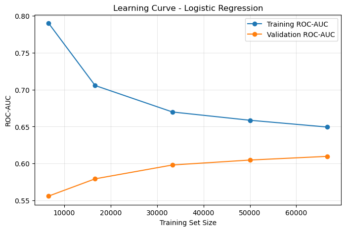
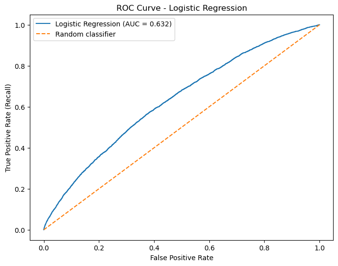
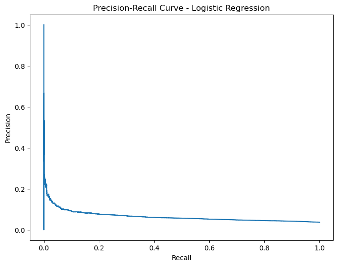

# Porto Seguro – Safe Driver Prediction

## Project Overview

This repository presents my individual contribution to an academic group project developed for the **Advanced Data Analytics** course.

The project is based on the **Porto Seguro Safe Driver Prediction** dataset and focuses on an insurance-risk classification problem: predicting whether a policyholder is likely to file a claim.

The main challenge is the strong class imbalance. In the dataset used in the notebook, the target contains:

- **573,518 observations of class 0**
- **21,694 observations of class 1**
- approximately **3.64% positive cases**

Because of this imbalance, model evaluation does not rely on accuracy alone. Particular attention is given to **ROC-AUC, Normalized Gini, Recall, Precision, and F1-score**.

> **Scope of this repository:** preprocessing, Logistic Regression, class-imbalance handling, Neural Networks, cross-validation, learning curves, dimensionality reduction, and hyperparameter optimization.

---

## Dataset

The notebook loads the Porto Seguro dataset directly from **OpenML** using:

```python
fetch_openml(data_id=42742, as_frame=True)
```

Dataset dimensions used in the notebook:

- **595,212 observations**
- **57 input features**

A stratified 80/20 train-test split is used:

- Training set: **476,169 × 57**
- Test set: **119,043 × 57**

---

## Preprocessing

The preprocessing workflow treats feature types separately.

### Numerical features

- Median imputation
- Standardization with `StandardScaler`

### Categorical features

- Conversion to a consistent object type
- Missing category replacement with `"Missing"`
- One-Hot Encoding with `handle_unknown="ignore"`

The 14 categorical variables produce **184 encoded features**.

### Binary features

- Converted to numeric floating-point values

After preprocessing, the feature matrix contains **227 features**:

- Training matrix: **476,169 × 227**
- Test matrix: **119,043 × 227**

The preprocessing workflow was later integrated into a reproducible Scikit-Learn `Pipeline` with a `ColumnTransformer`.

---

## Models and Experiments

The following approaches were evaluated:

1. Logistic Regression
2. Balanced Logistic Regression
3. Neural Network (`MLPClassifier`)
4. Neural Network with Random Undersampling
5. Logistic Regression with TruncatedSVD
6. Hyperparameter Optimization with `GridSearchCV`
7. Final Optimized Logistic Regression

---

## Model Comparison

| Model | Accuracy | Precision | Recall | F1-score | ROC-AUC |
|---|---:|---:|---:|---:|---:|
| Logistic Regression | 0.9635 | 0.3750 | 0.0007 | 0.0014 | 0.6316 |
| Logistic Regression (Balanced) | 0.6266 | 0.0539 | 0.5584 | 0.0983 | 0.6312 |
| Neural Network | 0.9636 | 0.0000 | 0.0000 | 0.0000 | 0.6286 |
| Neural Network (Undersampling) | 0.6565 | 0.0532 | 0.5013 | 0.0962 | 0.6170 |
| **Optimized Logistic Regression (C=0.01)** | **0.6263** | **0.0541** | **0.5607** | **0.0986** | **0.6317** |

The unbalanced models achieve high accuracy mainly because they predict the majority class. Balancing the Logistic Regression substantially improves minority-class detection.

---

## Learning Curve

The learning curve was calculated on a stratified development sample of **100,000 observations**.

Training ROC-AUC:

```text
[0.78979466 0.70562104 0.66975395 0.65857544 0.64939537]
```

Validation ROC-AUC:

```text
[0.55596254 0.57929510 0.59804352 0.60471512 0.60971291]
```



As the training size increases, the validation score improves while the training score decreases, reducing the gap between both curves.

---

## Dimensionality Reduction

`TruncatedSVD` was evaluated using 3-fold cross-validation.

| Experiment | Mean CV ROC-AUC |
|---|---:|
| Logistic Regression without SVD | 0.6097 |
| Logistic Regression + TruncatedSVD | 0.6111 |

The improvement from dimensionality reduction was small, so TruncatedSVD was not retained for the final model.

---

## Hyperparameter Optimization

`GridSearchCV` was used to test:

```python
model__C = [0.01, 0.1, 1, 10]
```

Best parameter:

```text
C = 0.01
```

Best 3-fold cross-validation ROC-AUC:

```text
0.6156159653
```

---

## Final Model

The final model is an optimized Logistic Regression with:

```python
LogisticRegression(
    C=0.01,
    max_iter=1000,
    class_weight="balanced",
    random_state=42
)
```

Final test results:

```text
Accuracy:        0.6263
Precision:       0.0541
Recall:          0.5607
F1-score:        0.0986
ROC-AUC:         0.6317
Normalized Gini: 0.2634
```

Confusion matrix:

```text
[[72127 42577]
 [ 1906  2433]]
```

The model detects approximately 56% of positive cases, but this comes with a high number of false positives.

---

## Cross-Validation Stability

The final model was evaluated using stratified 5-fold cross-validation.

ROC-AUC per fold:

```text
[0.63124636 0.63166057 0.62479877 0.62443940 0.62982698]
```

Normalized Gini per fold:

```text
[0.26249271 0.26332115 0.24959753 0.24887881 0.25965396]
```

Mean Normalized Gini:

```text
0.2567888319
```

Standard deviation:

```text
0.0062880465
```

The low standard deviation indicates relatively stable performance across folds.

---

## Visual Evaluation

### ROC Curve



### Precision-Recall Curve



---

## Key Findings

- **Accuracy is misleading** for this highly imbalanced classification problem.
- Explicitly addressing class imbalance substantially improves Recall.
- The Neural Network did not outperform Logistic Regression in this experiment.
- TruncatedSVD produced only a marginal cross-validation improvement.
- Hyperparameter tuning identified `C=0.01` as the best tested value.
- The optimized balanced Logistic Regression achieved the strongest overall result among my tested variants.

---

## Technical Challenges

During development, several implementation issues were resolved:

- combining numerical, categorical, binary, and sparse outputs in one preprocessing workflow;
- type conflicts between float and object columns;
- Scikit-Learn scorer compatibility when implementing a custom Gini scorer.

For cross-validation, ROC-AUC was used as the stable scoring metric and Normalized Gini was calculated as:

```text
Normalized Gini = 2 × ROC-AUC - 1
```

---

## Technologies

- Python
- Jupyter Notebook
- pandas
- NumPy
- SciPy
- Matplotlib
- scikit-learn

Main Scikit-Learn components:

- `SimpleImputer`
- `StandardScaler`
- `OneHotEncoder`
- `ColumnTransformer`
- `Pipeline`
- `LogisticRegression`
- `MLPClassifier`
- `StratifiedKFold`
- `learning_curve`
- `TruncatedSVD`
- `GridSearchCV`

---

## Project Structure

```text
porto-seguro-safe-driver-prediction/
│
├── README.md
├── requirements.txt
├── .gitignore
│
├── notebooks/
│   └── porto_seguro_safe_driver_prediction.ipynb
│
└── images/
    ├── roc_curve.png
    ├── precision_recall_curve.png
    └── learning_curve.png
```

---

## How to Run

1. Clone the repository.
2. Create a Python environment.
3. Install the dependencies:

```bash
pip install -r requirements.txt
```

4. Open the notebook:

```bash
jupyter notebook notebooks/porto_seguro_safe_driver_prediction.ipynb
```

The dataset is retrieved from OpenML when the notebook runs, so no local dataset file is required.

---

## Author

**Melanie Florine Noubissi Chimi**

Individual contribution to the **Porto Seguro Safe Driver Prediction** academic group project.

---

## Note

This repository documents my own modelling contribution to a collaborative university project. Results shown here are generated from the accompanying notebook.
