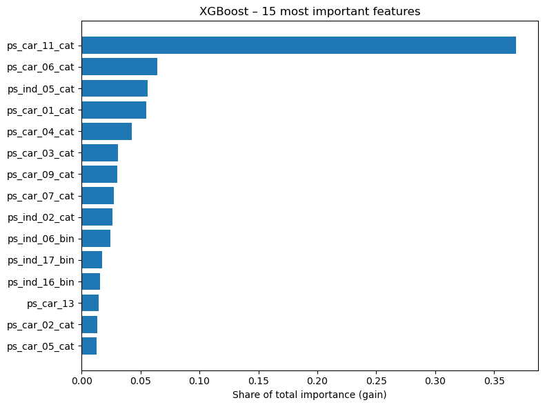
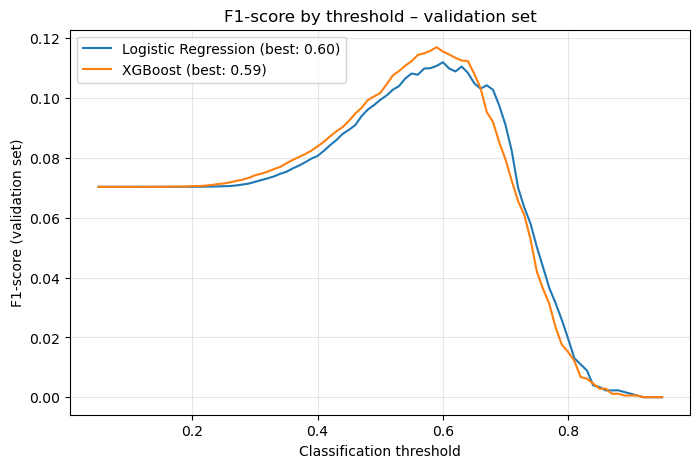
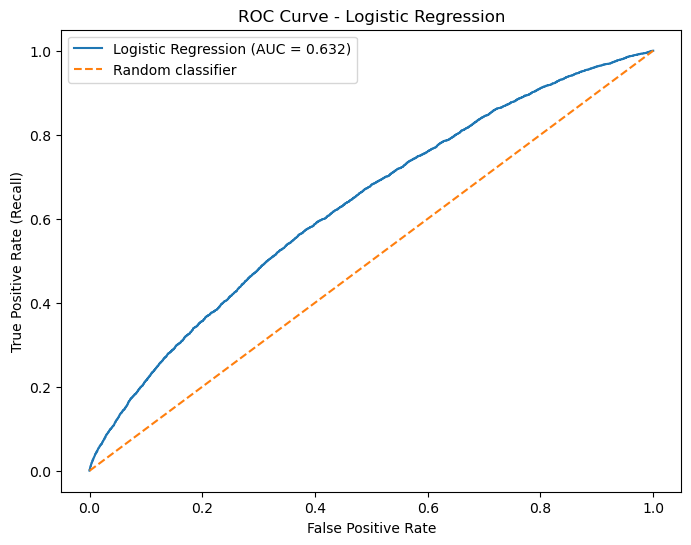
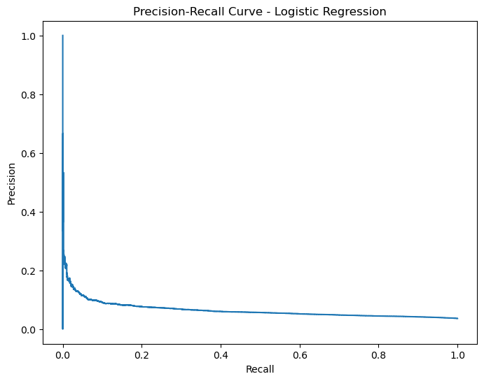
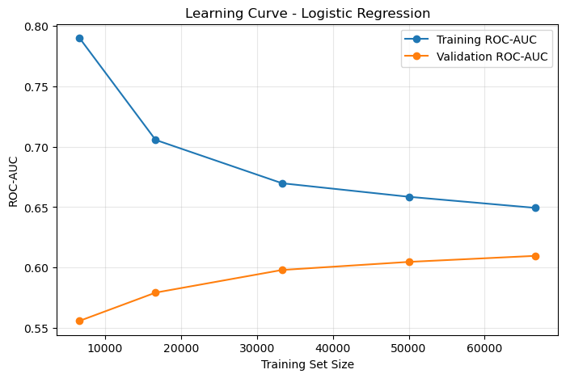

# Porto Seguro – Insurance Claim Prediction

**Machine learning project: classifying rare insurance claims in 595,212 car insurance policies**

Python · Scikit-learn · XGBoost · Pipelines · Cross-Validation · Imbalanced Classification

*Deutsche Version: [README.md](README.md)*

---

## Results at a Glance

| Area | Result |
|---|---|
| **Data** | 595,212 insurance policies, 57 anonymized features, only **3.64 %** with a claim |
| **Preprocessing** | Scikit-learn pipelines (imputation, scaling, one-hot encoding) fitted on training data only |
| **Best model** | **XGBoost**: test ROC-AUC **0.636**, Normalized Gini **0.272** (Logistic Regression: 0.631 / 0.263) |
| **Class imbalance** | Class weights raise recall from 0.07 % to 56 %; accuracy alone is misleading |
| **Threshold** | Chosen on a separate validation set: F1-score 0.099 → **0.114**, about 28,000 fewer false positives |
| **Business value** | The 10 % riskiest policies contain **21.5 %** of all claims (2× a random selection) |
| **Feature analysis** | `ps_car_11_cat` is the most important feature; removing the 20 `ps_calc_*` features slightly improves the model |
| **Validation** | Stratified train/validation/test split; 5-fold cross-validation (Gini 0.257 ± 0.006) |



---

## 1. Project Overview

This repository documents my individual contribution to a university group project in the **Advanced Data Analytics** course.

The goal is to predict whether a policyholder will file an insurance claim, using the dataset of the Kaggle challenge *Porto Seguro's Safe Driver Prediction*.

**Business question:** Can a machine learning model identify policyholders who are more likely to file a claim – and how should the decision threshold be chosen when only 3.6 % of the policies have a claim?

Two types of error have different business consequences:

- **False negative:** an actual claim is not detected.
- **False positive:** a policy is flagged as risky although no claim occurs.

## 2. Dataset

The data are loaded directly from OpenML in the notebook:

```python
fetch_openml(data_id=42742, as_frame=True)
```

| Property | Value |
|---|---:|
| Observations | 595,212 |
| Features | 57 (14 categorical, 17 binary, 26 numerical) |
| Class 0 (no claim) | 573,518 |
| Class 1 (claim) | 21,694 |
| Share of positive class | 3.64 % |

The features are anonymized; their names only indicate the group (`ind`, `reg`, `car`, `calc`) and the type (`_cat`, `_bin`).

**Data split:**

| Dataset | Observations | Purpose |
|---|---:|---|
| Training | 476,169 | model training and cross-validation |
| of which validation | 95,234 | model comparison and threshold selection |
| Test | 119,043 | final evaluation only |

## 3. Methodology

### 3.1 Preprocessing

- **Numerical features:** median imputation and standardization
- **Categorical features:** missing values as a separate `"Missing"` category, one-hot encoding
- **Binary features:** conversion to numerical values

All steps are combined in a `Pipeline` with a `ColumnTransformer` and are learned on the training data only to avoid data leakage.

### 3.2 Models and Experiments

1. Logistic Regression (baseline and with `class_weight="balanced"`)
2. Neural Network (`MLPClassifier`), also with random undersampling
3. Dimensionality reduction with `TruncatedSVD`
4. Hyperparameter optimization with `GridSearchCV` (best `C = 0.01`)
5. Stratified 5-fold cross-validation with Normalized Gini
6. **XGBoost** with `scale_pos_weight` for the rare class
7. Test with and without the `ps_calc_*` features
8. **Threshold selection on the validation set** (maximum F1-score)
9. Feature importance (XGBoost gain, mapped back to the original features)

## 4. Model Comparison (Test Data)

| Model | Threshold | Precision | Recall | F1-score | ROC-AUC | Gini | Top-10 % capture |
|---|---:|---:|---:|---:|---:|---:|---:|
| Logistic Regression | 0.50 | 0.375 | 0.001 | 0.001 | 0.632 | 0.263 | 20.7 % |
| Logistic Regression (balanced) | 0.50 | 0.054 | 0.558 | 0.098 | 0.631 | 0.262 | 20.4 % |
| Neural Network | 0.50 | 0.000 | 0.000 | 0.000 | 0.629 | 0.257 | 21.3 % |
| Neural Network + undersampling | 0.50 | 0.053 | 0.501 | 0.096 | 0.617 | 0.234 | 19.6 % |
| Optimized Logistic Regression (C = 0.01) | 0.50 | 0.054 | 0.561 | 0.099 | 0.632 | 0.263 | 20.5 % |
| Logistic Regression – validated threshold | 0.60 | 0.071 | 0.268 | 0.112 | 0.631 | 0.263 | 20.6 % |
| **XGBoost – validated threshold** | **0.59** | **0.073** | **0.266** | **0.114** | **0.636** | **0.272** | **21.5 %** |

*Top-10 % capture:* share of all claims among the 10 % of policies with the highest predicted risk (random selection: 10 %).

**Interpretation:**

- Without handling the class imbalance, the models reach 96 % accuracy but detect almost no claims.
- XGBoost ranks risky policies best, but the improvement over Logistic Regression is moderate. The anonymized features contain only limited information about future claims.
- A threshold chosen on the validation data reduces the number of false positives from about 42,600 to 14,700 and improves the F1-score.
- Without the 20 `ps_calc_*` features, the validation ROC-AUC of XGBoost increases slightly (0.6407 → 0.6435): these features apparently contain no useful signal.

## 5. Visualizations

### Threshold Selection



The F1-score peaks at a threshold of about 0.6 – clearly above the default of 0.5.

### ROC and Precision-Recall Curves (Logistic Regression)





### Learning Curve



With more training data, the validation ROC-AUC increases while the training ROC-AUC decreases: the model benefits from additional data.

## 6. Business Insights and Limitations

**Insights:**

1. **Accuracy alone is not enough.** With 3.6 % positive cases, a high accuracy is misleading.
2. **The model is better suited for ranking than for yes/no decisions.** The 10 % riskiest policies contain 21.5 % of all claims – a basis for risk-based pricing or prioritized underwriting reviews.
3. **More complex models are not automatically much better.** XGBoost improves the Gini only moderately; the Neural Network does not outperform Logistic Regression.
4. **The threshold is a business decision.** It should be chosen on separate data and ideally based on real costs.

**Limitations:**

- The features are anonymized and cannot be interpreted in business terms.
- The threshold was optimized for the F1-score, not for the actual costs of wrong decisions.
- XGBoost was not systematically tuned; gain importance does not show the direction of an effect.
- Next steps: model without `ps_calc_*`, cross-validated hyperparameter tuning for XGBoost and SHAP values for interpretation.

## 7. Project Structure and Installation

```text
porto-seguro-safe-driver-prediction/
│
├── README.md
├── README_EN.md
├── requirements.txt
│
├── notebooks/
│   └── porto_seguro_safe_driver_prediction.ipynb
│
└── images/
    ├── feature_importance.png
    ├── threshold_selection.png
    ├── roc_curve.png
    ├── precision_recall_curve.png
    └── learning_curve.png
```

```bash
git clone https://github.com/Mel95-web/porto-seguro-safe-driver-prediction.git
cd porto-seguro-safe-driver-prediction
python -m venv .venv
source .venv/bin/activate        # Windows: .venv\Scripts\activate
pip install -r requirements.txt
jupyter notebook notebooks/porto_seguro_safe_driver_prediction.ipynb
```

The dataset is loaded directly from OpenML. On macOS, XGBoost can also be installed with `conda install -c conda-forge xgboost`.

## 8. My Contribution and Technologies

This project was developed as part of a university group project in the **Advanced Data Analytics** course. All analyses and implementations documented in this repository were carried out by me.

**My contribution:** data preprocessing and pipelines, class-imbalance handling, Logistic Regression, Neural Networks, XGBoost, cross-validation, hyperparameter optimization, dimensionality reduction, threshold selection, feature analysis, and the evaluation and documentation of the results.

**Technologies:** Python · pandas · NumPy · SciPy · scikit-learn (Pipeline, ColumnTransformer, GridSearchCV, StratifiedKFold, TruncatedSVD, MLPClassifier) · XGBoost · Matplotlib · Jupyter Notebook

---

**Author:** Melanie Florine Noubissi Chimi
